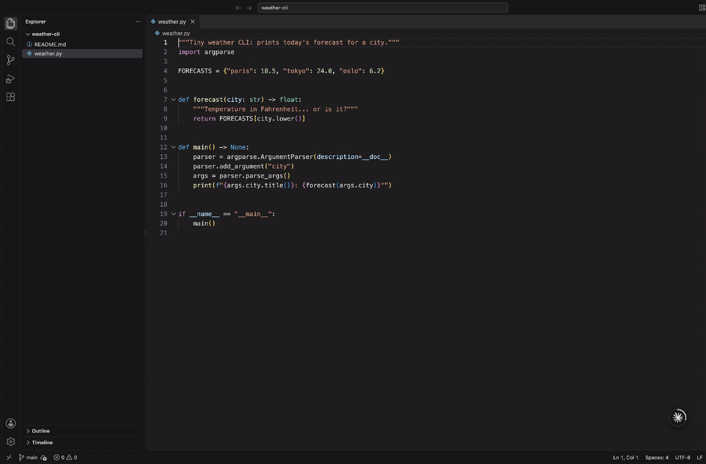
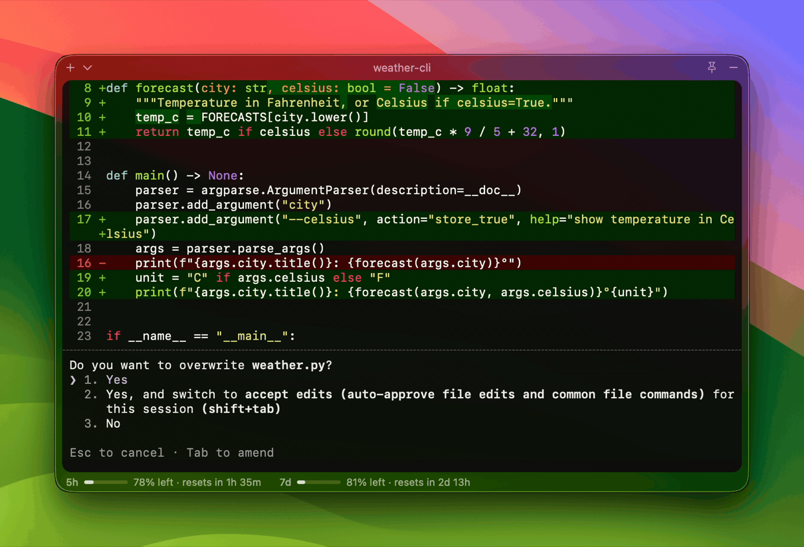
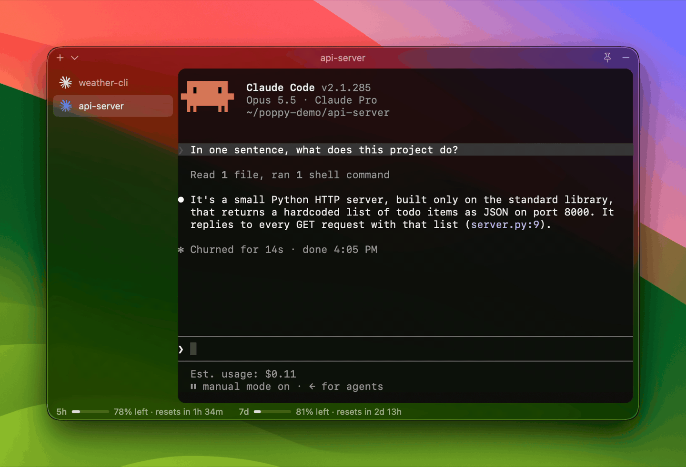
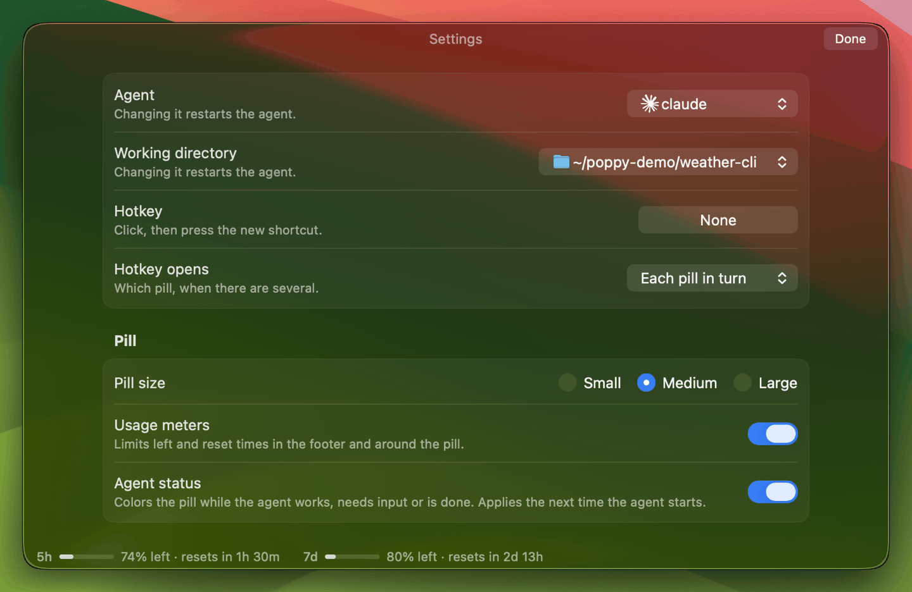

<div align="center">

# Poppy

**A floating Liquid Glass terminal for your coding agent on macOS.**

A glass pill sits on top of everything, on every Space and over fullscreen apps.<br>
Click it and it opens into a real terminal running Claude Code, Codex, Antigravity, opencode, or any command you like.

  


[**▶ Watch the 1-minute demo**](docs/media/poppy-demo.mp4) · [Install](#install) · [Using it](#using-it) · [Configuration](#configuration)

</div>

## Why Poppy

Your agent works best when you can glance at it without switching apps. Poppy keeps it one click (or **⌃⌥Space**) away, and never takes focus from the app you're in: a fullscreen app stays fullscreen, and a click outside folds the panel back into the pill.

<table>
<tr>
<td width="50%"></td>
<td width="50%"></td>
</tr>
<tr>
<td><b>Over fullscreen apps.</b> The pill floats over your editor; the panel opens on top, and your code updates underneath as the agent works.</td>
<td><b>It tells you when it needs you.</b> Blue while working, orange when it needs your input, green when it's done, and it can open by itself.</td>
</tr>
<tr>
<td></td>
<td></td>
</tr>
<tr>
<td><b>Several agents at once.</b> Sessions in a sidebar (⌘T), as many pills as you like, and drag sessions between them.</td>
<td><b>Settings in the panel.</b> Agent, folder, hotkeys, Auto-Open, the terminal's look and more, one ⌘, away.</td>
</tr>
</table>

<div align="center">

<br>
<b>Not just for code.</b> Over full-screen Maps, Claude plans a day's walk in Paris and saves it as a note.
</div>

## Features

- **Agent status on the pill:** blue while the agent works, orange when it needs your input, green when it's done. **Auto-Open** can open the panel when the agent needs you or finishes, and **Fold when you send a prompt** puts it away while the agent works.
- **Conversations come back:** quit Poppy and reopen it, and each session resumes its conversation (Claude Code, Codex and opencode; Antigravity untested).
- **Usage meters** for Claude, Codex and Antigravity: a ring around the pill, and % left with reset times in the panel.
- **Images and files:** paste a screenshot with ⌘V, or drag files and images onto the terminal or the pill, and the agent gets their paths.
- **Several agents at once:** sessions in one pill's sidebar, several pills, and sessions dragged between pills with Liquid Glass effects.
- **Act on Selection** (optional): select something in any app, press a hotkey, and a Claude Code session works out what it is and answers or acts in that app.
- **A `poppy` command:** `poppy ~/code/myproject` opens the session in that folder, or starts one there.

## Requirements

- **macOS 26 (Tahoe)** for the Liquid Glass look. Poppy also runs on macOS 14–15 with a frosted-glass fallback, but that is less tested.
- **Apple Silicon or Intel.** The download runs natively on both; a build from source is for your Mac's chip.
- To build from source only: **Xcode 26, or its Command Line Tools** (Swift 6.2 and the macOS 26 SDK). Install the tools with `xcode-select --install`, or install Xcode from the App Store.
- **The agent you want to use**, installed and working in your terminal, e.g. [Claude Code](https://docs.claude.com/en/docs/claude-code) (`claude`), Codex (`codex`) or the [Antigravity CLI](https://antigravity.google) (`agy`).

## Install

### Download

Download **Poppy-<version>.dmg** from the [latest release](https://github.com/dquigles/poppy/releases/latest), open it and drag Poppy into Applications. It's signed and notarized by Apple, so it opens without warnings, and it updates itself: it checks for new versions once a day, and **Check for Updates…** in Poppy's menu checks now.

The setup at the first launch can install the `poppy` command (in `~/.local/bin`).

### Build from source

```sh
git clone https://github.com/dquigles/poppy.git
cd poppy
./scripts/install.sh
```

This builds Poppy and installs:

- **`Poppy.app`** in `/Applications`, or `~/Applications` if `/Applications` isn't writable.
- **The `poppy` command** in `~/.local/bin`. If that folder isn't on your `PATH`, the script tells you the line to add to `~/.zshrc`.

It then starts Poppy, which walks you through a short setup the first time. To update later, run `git pull` and `./scripts/install.sh` again.

You can put things elsewhere: `APP_DIR=~/Applications BIN_DIR=/usr/local/bin ./scripts/install.sh`.

Because you build Poppy yourself, macOS runs it without any "unidentified developer" warning. No paid Apple Developer account is involved. A build from source doesn't update itself.

macOS asks whether Poppy may access your Desktop or Documents folders when the agent works there (the agent runs inside Poppy, so its file access counts as Poppy's). If you have an Apple Development certificate (Xcode creates one for free when you sign in with your Apple ID under Xcode → Settings → Accounts), the build is signed with it and macOS remembers your answers across updates; otherwise it may ask again after each rebuild. Set `POPPY_SIGN_IDENTITY` to choose a certificate, or `-` to skip signing with one.

To start Poppy at login, turn on **Launch at login** in Poppy's Settings (⌘, in the panel).

## Using it

- **Click the pill**, or press **⌃⌥Space**, to open the panel. Click outside it, or press the hotkey again, to fold it back. The pin in the header keeps it open.
- **Drag the pill** to any corner or edge. The panel opens from the corner it's closest to. **Resize** the open panel by dragging its edges.
- **Change folder:** click the session's name at the top of the panel for its folder, your recent folders, and Choose Folder…
- **Sessions:** ⌘T (or ＋ in the header; ⌄ beside it for another agent, a folder or a plain terminal) starts another session in the same pill; ⌘1–9 switch, ⌘W closes. With two or more, a sidebar lists them; drag a row out to give it its own pill, or drop a pill on another to merge them.
- **Pills:** New Pill in the menu gives you another pill, with its own sessions and place on screen. Only one is open at a time. "Hotkey opens" in Settings picks which one the hotkey opens: the one you used last, the one that needs you most, or each in turn. Closing a pill's last session removes it. Poppy remembers your pills and sessions, and resumes their conversations next time.
- **Settings** (⌘, in the panel, or Settings… in the menu): agent, working folder, hotkeys, pill size, usage meters, agent status, Auto-Open, keeping the panel open, fading and hiding the pill, the terminal's font, theme and cursor, launch at login.
- **Right-click the pill** (or use Poppy's menu bar icon) to switch agent or folder, restart the agent, start sessions and pills, open Settings, or quit.

### The `poppy` command

```text
poppy [options] [directory]

Opens Poppy on a session in <directory> (default: the current directory): the
one already there if there is one (never restarting it), else a new session in
the most recent pill. Options are saved, like changing them in Poppy's menu.

  -a, --agent NAME        claude, codex, agy, opencode, or an agent name from config.json
  -c, --command CMD       run CMD (any shell command) as the agent
                          (with -a or -c, only a session running that agent is reused)
      --new               always a new session, in the most recent pill
      --new-pill          always a new pill
      --pill SIZE         small, medium or large
      --auto-open WHEN    input, done, both or off
      --focus             Auto-Open takes the keyboard
      --no-focus          Auto-Open only shows the panel
      --usage             show usage
      --no-usage          hide usage
  -b, --background        don't expand the panel
  -h, --help              show this help
```

## Configuration

Settings live in `~/.config/poppy/config.json`, created on first launch. Most of them are also in the menu. Some examples:

```json
{
  "command": "claude",
  "cwd": "~",
  "hotkey": "ctrl+opt+space",
  "agents": [
    { "name": "Claude (skip perms)", "command": "claude --dangerously-skip-permissions" }
  ]
}
```

- `command` is a shell command, run through your login shell, so your `PATH`, aliases and functions work.
- `agents` adds extra entries to the Agent menu.
- `"statusHooks": false` turns off status reporting (see below).

Poppy reads this file when it starts, so restart Poppy after editing it.

## What Poppy touches on your system

- **Status hooks.** To show the agent's status, Poppy adds small hooks to each agent's config. Each hook only writes one word to a file Poppy gives it, and does nothing when the agent isn't running inside Poppy.
  - Claude Code: a separate settings file, `~/.config/poppy/claude-hooks.json`, passed with `--settings`. Your own settings are untouched.
  - Codex: entries appended to `~/.codex/hooks.json`. Codex asks you once to approve them.
  - Antigravity: a plugin, `~/.gemini/config/plugins/poppy-status/`. That folder is shared with the Antigravity desktop app and IDE, where the plugin does nothing. Antigravity has no hook for "waiting for you", so its pill never turns orange: it stays blue while Antigravity asks you to approve a command, and idle while it asks whether to trust a new folder.
  - opencode: a plugin, `~/.config/opencode/plugins/poppy-status.ts`.
  - The same hooks also tell Poppy each session's conversation id, so it can resume it when you reopen Poppy.
  - It only adds entries; it never removes or changes yours. Turn this off with **Agent status** in Settings (or `"statusHooks": false`).
- **Usage meters.**
  - For Claude, Poppy runs Claude Code's own `/usage` command (`claude -p /usage`): no model call, not saved as a session, and with your user settings skipped, so hooks in your own Claude Code settings don't fire for it (organization-managed settings still apply). Poppy never reads your Claude login.
  - For Codex, it asks `codex app-server` for its rate limits.
  - For Antigravity, it runs `agy -p /usage` (no model call), only after checking that `agy` is signed in (it looks for `agy`'s login in your Keychain by name, without reading it), since a signed-out `agy` would open a browser sign-in page.
  - Turn the meters off with **Show usage meters** in Settings (**Settings…** in the menu, or ⌘, in the panel).
- **Updates** (the downloaded Poppy only): once a day, Sparkle fetches the latest release's `appcast.xml` from GitHub. Nothing about you or your Mac is sent.
- **Pasted and dropped images** are saved as PNGs in a private temporary folder and deleted after a week.

Poppy itself needs no special permissions. Only **Act on Selection**, if you turn it on, needs **Accessibility** (to read the selection and act on the app's controls) and, for its screenshot mode, **Screen Recording**; the setup asks for them only then.

## Uninstall

```sh
pkill -x poppy; pkill -x poppy-dev
rm -rf /Applications/Poppy.app ~/.local/bin/poppy ~/.config/poppy ~/.config/poppy-dev ~/.gemini/config/plugins/poppy-status
defaults delete io.github.dquigles.poppy 2>/dev/null  # the downloaded Poppy's update settings
```

Then remove Poppy's hook entries from `~/.codex/hooks.json` if you used Codex: each entry mentions `POPPY_STATUS_FILE`. Also delete `~/.config/opencode/plugins/poppy-status.ts` if it's there.

## Development

```sh
swift build                   # debug build
swift test                    # unit tests: hooks, resuming, config, usage parsing, hotkeys, the poppy command…
./scripts/dev.sh              # build Poppy Dev (debug) and (re)start it; log in build/poppy-dev.log
./scripts/dev.sh --stop       # stop it
./scripts/test-features.py    # scripted tests against Poppy Dev (also test-sessions.py, test-pills.py, test-drag.py)
./scripts/bundle.sh --release # build build/Poppy.app (what install.sh installs)
./scripts/release.sh          # the downloadable DMG: universal, signed, notarized (needs a Developer ID)
```

Pushing a `v*` tag (e.g. `git tag v0.2.0 && git push origin v0.2.0`) builds and publishes a release on GitHub Actions.

**Poppy Dev** is a second copy you can run beside your installed Poppy, so you can work on Poppy with an agent inside Poppy: changes are tested in Poppy Dev while the agent keeps running. It has its own settings in `~/.config/poppy-dev/`, no hotkey until you set one, and a purple DEV tag on its pill. Run `./scripts/install.sh` from a normal terminal (it restarts your installed Poppy, and the agent in it) when you want the changes in your real Poppy.

The design and its reasoning live in [`docs/DESIGN.md`](docs/DESIGN.md), and milestone history in [`docs/PROGRESS.md`](docs/PROGRESS.md).

## License

[MIT](LICENSE). The agent logos in `Resources/Logos` are from [lobe-icons](https://github.com/lobehub/lobe-icons); their license is in `Resources/Logos/src/LICENSE-lobe-icons`.
